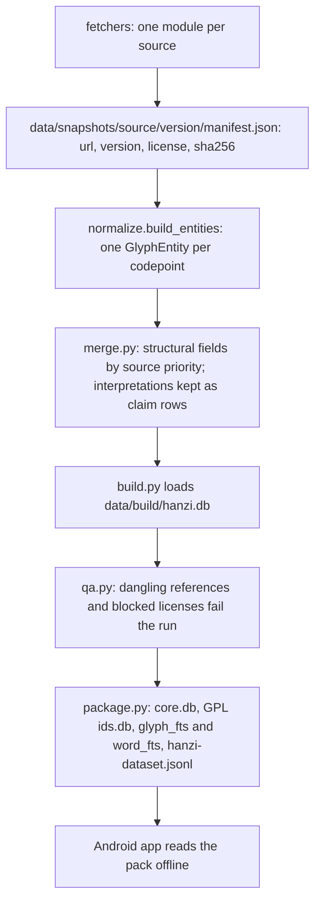

# Hanzi Dictionary

An offline Chinese-character dictionary whose content pack is built by a small, reproducible data pipeline.

Fetchers snapshot each source with the URL, version, license, and file hashes it was taken from. The build resolves one record per codepoint, merges the structural fields in a fixed source order, and keeps interpretive statements as claim rows attributed to the source that made them. Packaging splits the result into `core.db` and a separately licensed `ids.db`, builds FTS5 indexes, and exports JSONL. A Kotlin Android app reads that pack with no network. The product spec is [`docs/hanzi-dictionary-spec-v1.md`](docs/hanzi-dictionary-spec-v1.md).

## Pipeline



`build()` keeps a codepoint when it has a decomposition and a pinyin reading (`select_t1_t2`), resolves each decomposition with `merge.resolve_decomposition`, and also loads words, example sentences, and confusable pairs into `hanzi.db`. `qa.py` prints the IDS parse rate and the diff against the previous `build_stats.json`; those two reports do not fail the run. `package.py` then splits the database.

## Schema

The pack schema is [`pipeline/pipeline/schema.sql`](pipeline/pipeline/schema.sql). `load.py` fills the tables below. `script_form` and `audio` are declared in the same file and have no loader. `claim.subject_id` is not a foreign key; the schema comment says it is usually a glyph id. `component_use.component_id` and `phonetic_series.component_id` hold a glyph id or an `ids:` pseudo-id for a part that has no codepoint. `sentence.simp` matches `word.simp` and is not a foreign key.

```mermaid
erDiagram
    source ||--o{ reading : source_id
    glyph ||--o{ reading : glyph_id
    source ||--o{ decomposition : source_id
    glyph ||--o{ decomposition : glyph_id
    glyph ||--o{ component_use : glyph_id
    source ||--o{ claim : source_id
    glyph ||--o{ variant_edge : from_glyph
    glyph ||--o{ variant_edge : to_glyph
    source ||--o{ variant_edge : source_id
    word ||--o{ word_char : word_id
    glyph ||--o{ word_char : glyph_id
    glyph ||--o{ confusable : glyph_a
    glyph ||--o{ confusable : glyph_b

    source {
        TEXT id PK
        TEXT name
        TEXT license
        TEXT url
        TEXT version
        TEXT ingest_date
    }
    glyph {
        TEXT id PK
        TEXT char
        TEXT scripts
        INTEGER stroke_count
        INTEGER freq_rank
        INTEGER hsk
        TEXT definition
        TEXT cedict_defs
    }
    reading {
        TEXT glyph_id FK
        TEXT system
        TEXT value
        TEXT sense_hint
        INTEGER freq
        TEXT source_id FK
    }
    decomposition {
        TEXT glyph_id FK
        TEXT ids
        TEXT region
        TEXT source_id FK
    }
    component_use {
        TEXT glyph_id FK
        TEXT component_id
        INTEGER position
        TEXT function
        TEXT match_class
        REAL confidence
        TEXT resolution
    }
    claim {
        TEXT subject_id
        TEXT predicate
        TEXT value
        TEXT source_id FK
        TEXT source_ref
        REAL confidence
        TEXT retrieved_at
    }
    variant_edge {
        TEXT from_glyph FK
        TEXT to_glyph FK
        TEXT relation
        TEXT mapping_type
        TEXT sense_condition
        TEXT source_id FK
    }
    phonetic_series {
        TEXT component_id PK
        INTEGER member_count
        REAL reliability
        TEXT best_stratum
    }
    word {
        TEXT id PK
        TEXT simp
        TEXT trad
        TEXT pinyin
        TEXT defs
        INTEGER freq_rank
        INTEGER hsk
    }
    word_char {
        TEXT word_id FK
        TEXT glyph_id FK
        INTEGER position
    }
    sentence {
        TEXT simp
        TEXT zh
        TEXT en
        INTEGER tatoeba_id
        INTEGER quality
        INTEGER shown
    }
    component_gloss {
        TEXT component_id PK
        TEXT gloss
        TEXT source_id
        INTEGER support
        REAL agreement
    }
    confusable {
        TEXT glyph_a FK
        TEXT glyph_b FK
        TEXT kind
        TEXT diff
    }
```



## Design decisions

### Two databases, two drivers

`package.build_ids_db` copies cjkvi-ids decomposition rows into `ids.db`. `build_core_db` copies the other content tables into `core.db` and leaves those rows out of `decomposition` there. GPL-2.0 stays in its own file, so it does not cover the rest of the pack. `HanziRepository` and `PackManager` open one driver per file. An `ATTACH` would stick to a single pooled connection, so anything that needs both files is merged in Kotlin. SQL cannot join across the two files.

### Structural fields merge; interpretations stay claims

`merge.resolve_decomposition` walks a fixed order: cjkvi-ids ahead of makemeahanzi, and within cjkvi-ids a script-matching region tag ahead of an untagged row. A decomposition whose parts are all encoded characters wins over a higher-priority row that bottoms out in an unencoded shape (`is_navigable`), because the character page has to be able to open the part. Simplified/traditional edges are the union of Unihan and OpenCC, classified as `merger`, `systematic`, or `irregular (unclassified)`. Component function and etymology text are `claim` rows with a `source_id`. `merge.py` does not vote them into one value. The pack is wider, and a disagreement stays visible on `component_use.resolution`.

### Snapshots are immutable and self-describing

Each fetcher writes `data/snapshots/<source>/<version>/manifest.json` with url, version, license, `retrieved_at`, and a sha256 per file (`fetchers/common.py`). A version that already has a manifest is skipped unless `--force`. A rebuild does not re-download, and the license stored on the `source` row is the one recorded at fetch time. The cost is disk, and a build is only as new as the snapshots on disk. `fetch_all` does not fetch CC-CEDICT, TED2020, or the Dong lexicon. `build()` requires the CC-CEDICT snapshot (`SOURCES`) and reads the other two only when their snapshot directories exist.

### The content pack is replaced; user state is migrated

`package.py` sets `PRAGMA user_version = 1` and ships no migrations for the pack. `PackManager` copies `core.db` and `ids.db` out of assets and re-copies them when `BUNDLED_PACK_VERSION` changes. Learner state is a separate database; its upgrades are the numbered `.sqm` files next to `User.sq`. A pack update cannot carry a row-level delta. An archive built on the device survives a content swap.

### The pipeline stays on the standard library

Fetch, parse, merge, QA, and packaging import only the Python 3.12 standard library. GitHub-hosted sources are shallow-cloned by shelling out to `git` (`git_shallow_clone`). Nothing is installed before `python -m pipeline.build` or the pipeline tests. Each source's text format has a hand-written parser.

### QA fails closed on integrity and license

`qa.py` exits non-zero when a referenced row is missing or a source license contains `NC`, `PRIVATE`, or `UNCONFIRMED` (`BLOCKED_LICENSE_MARKERS`). The IDS parse rate and the diff against `build_stats.json` are printed and do not fail the run, so a shift in coverage of rare characters is left for a person to read. A green QA run is not a full review of the glosses.

## Run it

Python 3.12, from `pipeline/`. Snapshots and build output are gitignored (`pipeline/data/snapshots/`, `pipeline/data/build/`).

```bash
cd pipeline
python3 -m fetchers.fetch_all
python3 -m fetchers.fetch_cedict
python3 -m pipeline.build
python3 -m pipeline.qa
python3 -m pipeline.package
```

`fetch_all` downloads the sources in `FETCHERS`. CC-CEDICT is separate because `build()` reads it and `fetch_all` does not fetch it. `pipeline.package` writes `core.db`, `ids.db`, `hsk-levels.json`, and `hanzi-dataset.jsonl` under `data/build/`.

The Android app needs JDK 17 and an Android SDK (`ANDROID_HOME`). `:core` is pure Kotlin. `:androidApp` is the Compose UI. From the repo root, after the pack exists:

```bash
cp pipeline/data/build/core.db pipeline/data/build/ids.db pipeline/data/build/hsk-levels.json app/androidApp/src/main/assets/
app/gradlew -p app :androidApp:assembleDebug
```

The debug APK is under `app/androidApp/build/outputs/apk/debug/`. The copied assets are gitignored.

## Tests

The pipeline tests are stdlib `unittest` and do not need snapshots or a built pack. Run them from `pipeline/`:

```bash
cd pipeline && python3 -m unittest discover -s tests
```

`:core` is JVM tests, run with JDK 17. Gradle still configures `:androidApp`, so `ANDROID_HOME` has to point at an Android SDK. No device:

```bash
app/gradlew -p app :core:test
```

`HanziRepositoryTest` opens `pipeline/data/build/core.db` and `ids.db`. Both files are gitignored, so on a fresh clone that test is skipped. When both files are present it runs the same checks. The other `:core` tests use in-memory SQLite.

## Data licensing

Per-source terms and the full texts are [`docs/ATTRIBUTIONS.md`](docs/ATTRIBUTIONS.md) and [`LICENSES/`](LICENSES/).

Two sources are personal-build only and must not ship in a pack you distribute:

- **TED2020** (OPUS en-zh_cn), CC BY-NC-ND 4.0. `fetchers/fetch_opus.py` is not in `fetch_all`. `build()` adds its sentences only when the snapshot is present, to fill words the Tatoeba export does not cover. A checkout without that snapshot builds a Tatoeba-only sentence table.
- **Dong Chinese lexicon** (`peterolson/chinese-lexicon`). `fetchers/fetch_dong_chinese.py` records the license as unconfirmed for publication and is not in `fetch_all`. When the snapshot is present, `build()` uses it as the component-function override for the characters it covers. Without the snapshot, those rows stay on the detector.

`qa.py` fails a build whose `source` table contains `NC`, `PRIVATE`, or `UNCONFIRMED`, which is the gate those two licenses trip. Leave the snapshots out of any pack you redistribute.

`ids.db` is the cjkvi-ids decompositions (GPL-2.0) and nothing else. `core.db` is the remaining tables, including the computed phonetic layer. The JSONL export repeats a source name and license on each contributed field.

## License

Code in this repository is MIT, Copyright (c) 2026 Ethan Zhou ([`LICENSE`](LICENSE)). Data, fonts, the HSK word list, and the py-fsrs test vectors keep the licenses named in [`docs/ATTRIBUTIONS.md`](docs/ATTRIBUTIONS.md).
