# Hanzi Dictionary

[](https://github.com/ethanez713/hanzi-dictionary/actions/workflows/ci.yml)

**An offline Chinese dictionary for Android that teaches characters through their parts.**
Look up 晴 and it shows the sun radical that gives the meaning and the 青 that gives the
sound, then every other character built the same way.

Search by character, pinyin or English. Save what you look up into lists, study it with
spaced-repetition flashcards, and pull new characters straight out of the photos on your
phone. Everything runs on the device with no network, from a content pack that the
pipeline in this repo builds out of open datasets.

<table>
  <tr>
    <td width="25%">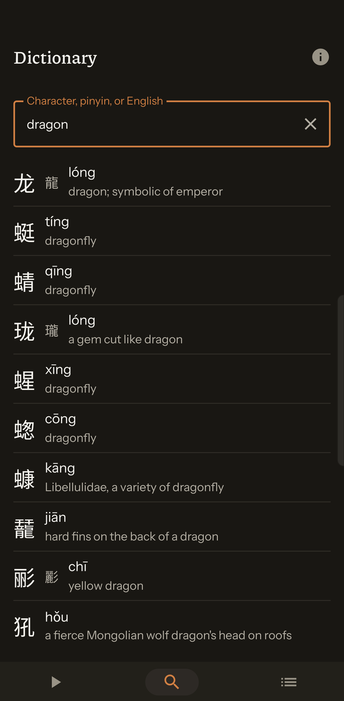</td>
    <td width="25%">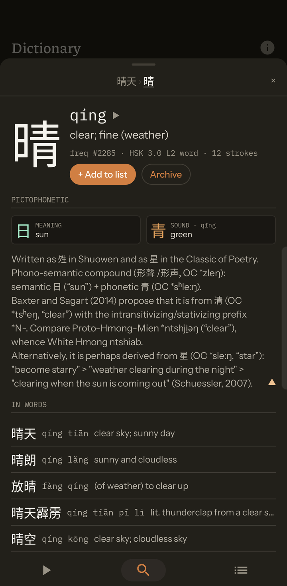</td>
    <td width="25%">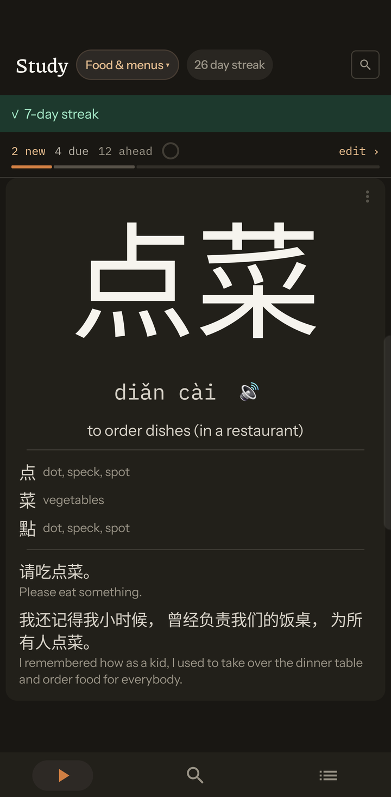</td>
    <td width="25%">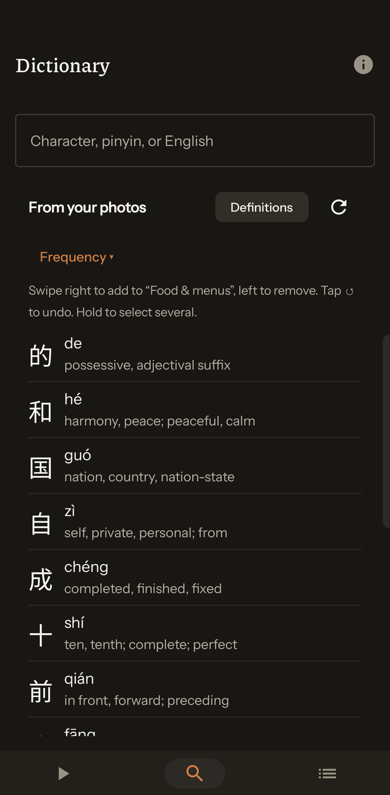</td>
  </tr>
  <tr>
    <td valign="top"><b>Search.</b> One box for characters, pinyin and English.</td>
    <td valign="top"><b>Character.</b> Meaning and sound components, etymology with its source, and the words it appears in.</td>
    <td valign="top"><b>Study.</b> Swipe right if you knew it, left if you didn't. The schedule does the rest.</td>
    <td valign="top"><b>From your photos.</b> Characters read from a menu or a sign, one swipe to file each.</td>
  </tr>
</table>

## What it does

- **Explains characters, not just translates them.** Each entry breaks into components
  with their roles, and links to the phonetic series: the other characters that share
  its sound part.
- **Words and sentences.** Definitions, example sentences with their corpus credited, and
  a tap through to any character inside a word.
- **Flashcards that schedule themselves.** FSRS-6 decides when each card is due. Two
  grades, swipe-only, with a home-screen widget and an optional reminder that are graded
  in place.
- **Photo capture.** On-device text recognition reads new photos and queues the
  characters it finds, most common first.
- **Lists.** Group what you are learning, with HSK levels built in. A character in three
  lists still has one memory.
- **Offline and private.** No account and no network. Your lists and review history stay
  in a database on the phone.

<details>
<summary>More screens</summary>

<table>
  <tr>
    <td width="33%">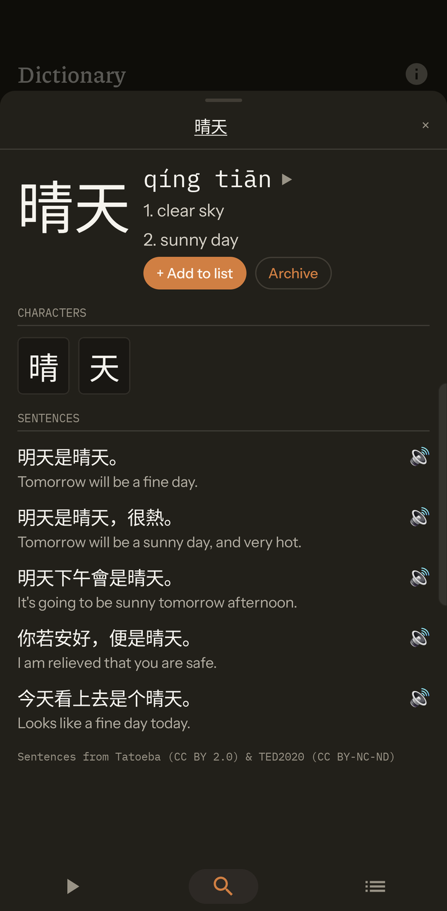</td>
    <td width="33%">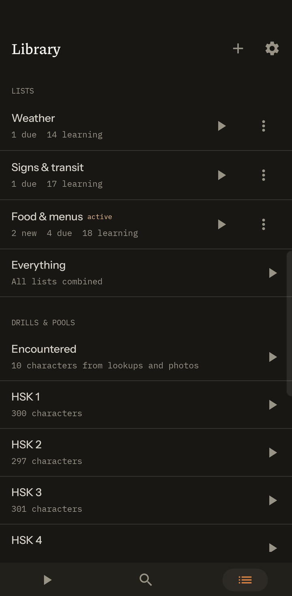</td>
    <td width="33%">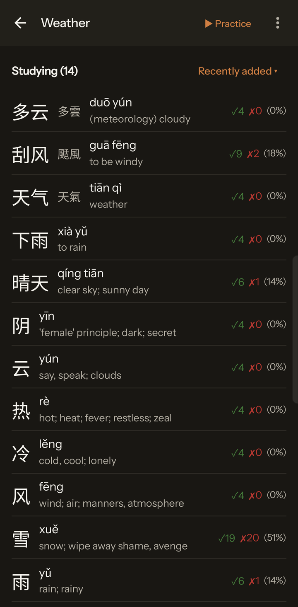</td>
  </tr>
  <tr>
    <td valign="top"><b>Word.</b> Definitions, its characters, and example sentences.</td>
    <td valign="top"><b>Library.</b> Your lists, the HSK pools, and everything you have encountered.</td>
    <td valign="top"><b>List.</b> Each item's record of right and wrong answers.</td>
  </tr>
  <tr>
    <td width="33%">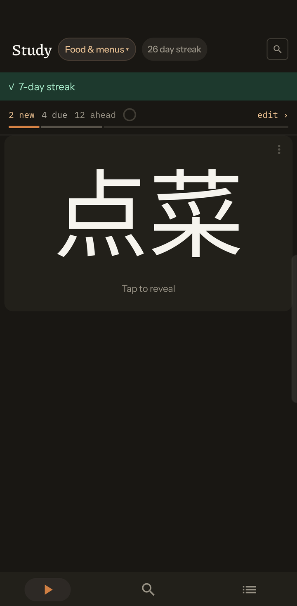</td>
    <td width="33%">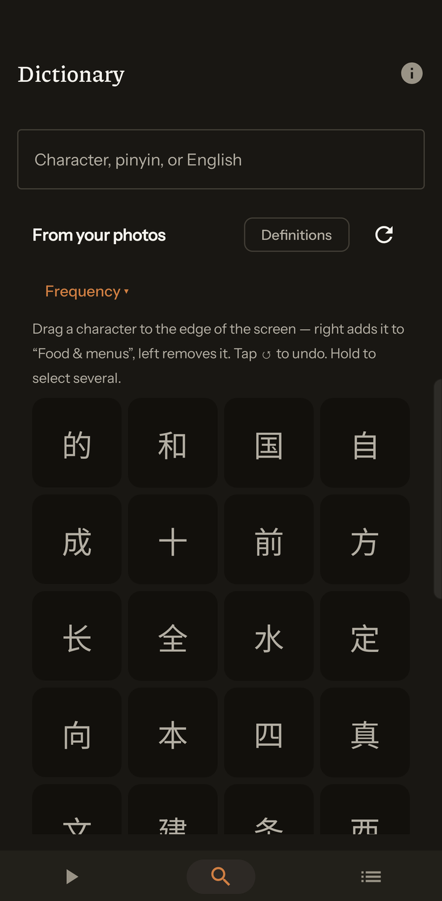</td>
    <td width="33%">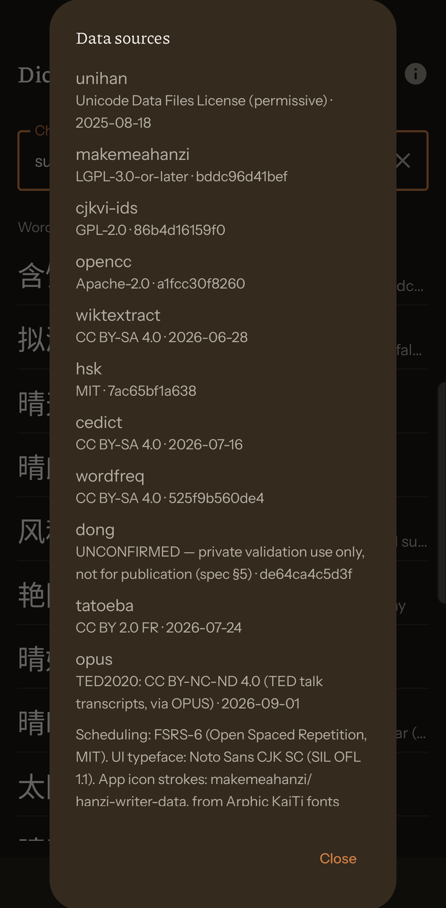</td>
  </tr>
  <tr>
    <td valign="top"><b>Study.</b> New cards first, then the ones due, lowest predicted recall first.</td>
    <td valign="top"><b>Photo finds.</b> The grid before definitions are switched on.</td>
    <td valign="top"><b>Provenance.</b> Every source in the pack, with its license and version.</td>
  </tr>
</table>

The lists and study history above are demo data: three invented lists, with a month of
reviews simulated by py-fsrs. The photo finds come from four openly licensed photos:
["Chinese menu"](https://commons.wikimedia.org/w/index.php?curid=165202870) by Roland Tanglao (CC0),
["A No Smoking Sign That Means Business"](https://www.flickr.com/photos/47038415@N00/306250135) by Augapfel,
["Directions at JiShuiTan Subway"](https://www.flickr.com/photos/29509789@N00/136175286) by ianholton, and
["Restaurant Sign Engrish"](https://www.flickr.com/photos/88175021@N00/3150260687) by rduta (the last three CC BY 2.0).

</details>

## The data pipeline

The content pack is the other half of the project: a reproducible build that turns open
sources (Unihan, CC-CEDICT, Wiktionary, Make Me a Hanzi, Tatoeba and others) into two
SQLite files.

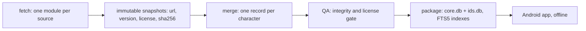

- **Provenance is data.** Every snapshot records where it came from and under what
  license, and the app shows it.
- **Facts merge; opinions stay attributed.** Structural fields are merged by source
  priority. Etymologies and component roles are stored as claims from the source that
  made them, so disagreements stay visible.
- **Licenses are enforced by the build.** GPL data ships in its own database file, and QA
  fails a pack that contains a source not cleared for redistribution.
- **No dependencies.** The pipeline is Python standard library only.

The stages, schema and design decisions are in [docs/PIPELINE.md](docs/PIPELINE.md).

## Run it

Python 3.12, from `pipeline/`. Snapshots and build output are gitignored (`pipeline/data/snapshots/`, `pipeline/data/build/`).

```bash
cd pipeline
python3 -m fetchers.fetch_all
python3 -m fetchers.fetch_cedict
python3 -m pipeline.build
python3 -m pipeline.qa
python3 -m pipeline.package
```

`fetch_all` downloads the sources in `FETCHERS`. CC-CEDICT is separate because `build()` reads it and `fetch_all` does not fetch it. `pipeline.package` writes `core.db`, `ids.db`, `hsk-levels.json`, and `hanzi-dataset.jsonl` under `data/build/`.

The Android app needs JDK 17 and an Android SDK (`ANDROID_HOME`). `:core` is pure Kotlin. `:androidApp` is the Compose UI. From the repo root, after the pack exists:

```bash
cp pipeline/data/build/core.db pipeline/data/build/ids.db pipeline/data/build/hsk-levels.json app/androidApp/src/main/assets/
app/gradlew -p app :androidApp:assembleDebug
```

The debug APK is under `app/androidApp/build/outputs/apk/debug/`. The copied assets are gitignored.

## Tests

The pipeline tests are stdlib `unittest` and do not need snapshots or a built pack. Run them from `pipeline/`:

```bash
cd pipeline && python3 -m unittest discover -s tests
```

`:core` is JVM tests, run with JDK 17. Gradle still configures `:androidApp`, so `ANDROID_HOME` has to point at an Android SDK. No device:

```bash
app/gradlew -p app :core:test
```

`HanziRepositoryTest` opens `pipeline/data/build/core.db` and `ids.db`. Both files are gitignored, so on a fresh clone that test is skipped. When both files are present it runs the same checks. The other `:core` tests use in-memory SQLite.

## Data licensing

Per-source terms and the full texts are [`docs/ATTRIBUTIONS.md`](docs/ATTRIBUTIONS.md) and [`LICENSES/`](LICENSES/).

Two sources are personal-build only and must not ship in a pack you distribute:

- **TED2020** (OPUS en-zh_cn), CC BY-NC-ND 4.0. `fetchers/fetch_opus.py` is not in `fetch_all`. `build()` adds its sentences only when the snapshot is present, to fill words the Tatoeba export does not cover. A checkout without that snapshot builds a Tatoeba-only sentence table.
- **Dong Chinese lexicon** (`peterolson/chinese-lexicon`). `fetchers/fetch_dong_chinese.py` records the license as unconfirmed for publication and is not in `fetch_all`. When the snapshot is present, `build()` uses it as the component-function override for the characters it covers. Without the snapshot, those rows stay on the detector.

`qa.py` fails a build whose `source` table contains `NC`, `PRIVATE`, or `UNCONFIRMED`, which is the gate those two licenses trip. Leave the snapshots out of any pack you redistribute.

`ids.db` is the cjkvi-ids decompositions (GPL-2.0) and nothing else. `core.db` is the remaining tables, including the computed phonetic layer. The JSONL export repeats a source name and license on each contributed field.

## License

Code in this repository is MIT, Copyright (c) 2026 Ethan Zhou ([`LICENSE`](LICENSE)). Data, fonts, the HSK word list, and the py-fsrs test vectors keep the licenses named in [`docs/ATTRIBUTIONS.md`](docs/ATTRIBUTIONS.md).
